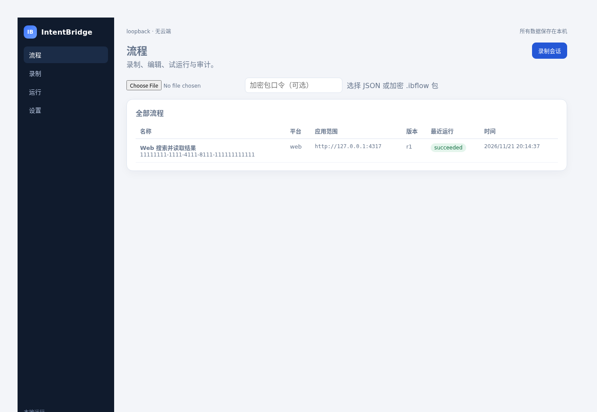
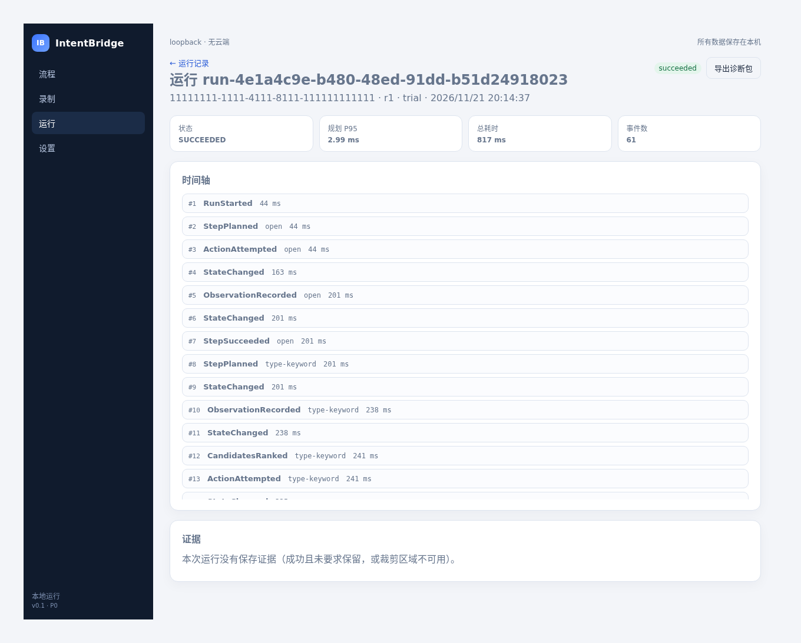

# IntentBridge

把 Android、Windows 桌面软件和 Web 页面中的操作录制成统一、可读的意图流程，并在同一平台确定性重放；界面发生有限变化时，用结构、语义、原生标识和视觉证据重新定位目标，拿不准就暂停请求人工确认。

**当前版本：0.1.0（M0 完成；M1 Web 垂直切片含 21 条黄金流程实测通过；M2/M3 源码 + 构建通过，OS 运行 NOT_RUN）。** 这不是概念演示：Web 端在真实 Chrome 中完成录制、回放、漂移语料、暂停审批、证据保存与管理界面端到端验证；Rust 状态机、跨端语义和持久化均有可重复测试。





---

## 现在到底能用什么

| 能力                                                                       | 状态                          | 证据                                                                            |
| -------------------------------------------------------------------------- | ----------------------------- | ------------------------------------------------------------------------------- |
| 统一 Action IR + JSON Schema + 版本迁移                                    | **可用**                      | `core/action-ir`，19 个单元/属性测试                                            |
| Rust 确定性执行状态机（原生 + WASM）                                       | **可用**                      | 32 个引擎测试、500 次虚拟长跑、47 个 Rust 测试                                  |
| Web 真实录制与确定性重放                                                   | **可用**                      | 真实 Chrome e2e：录制 → 校验 → 回放；10 次连续回放                              |
| 漂移重锚（移动/改 id/随机 id/慢加载/诱饵/改名）                            | **可用**                      | 9 例语料：7/7 可恢复，误执行 0，报告见 `artifacts/drift-report.json`            |
| 管理界面（流程/步骤/目标检查器/变量密钥/权限/试运行/时间轴/导入导出/设置） | **可用**                      | 真实浏览器 e2e：保存 r2、试运行成功、暂停决策、证据图片、1000 步 176ms 打开     |
| MV3 浏览器扩展（真实 Chromium 加载）                                       | **可用（有限）**              | 真实 Chromium 下 service worker、WASM、popup、content script 快照与输入操作验证 |
| 加密流程包 / 本地 SQLite / 密钥加密                                        | **可用**                      | API 集成测试（含错误口令、路径穿越、诊断脱敏）                                  |
| Windows .NET 8 + UIA 执行器与夹具                                          | **构建通过；OS 运行 NOT_RUN** | Linux 交叉编译 0 warning；见 `docs/BUILD-REPORT.md`                             |
| Android Kotlin + 无障碍服务 + JNI 与夹具                                   | **构建通过；OS 运行 NOT_RUN** | SDK 35/NDK 29 构建 APK（含 JNI）；见 `docs/BUILD-REPORT.md`                     |

“可用”指在本仓库的 Linux 验证环境里真实跑过并通过自动断言；"NOT_RUN" 不伪装成通过。

---

## 快速开始（Web）

```bash
cd intentbridge   # 仓库根目录
corepack enable && pnpm install          # Node >= 22（本机 24.22）
pnpm build                                # 构建 Rust/WASM、TS 包、扩展、管理界面
pnpm fixture:web                          # 夹具应用 http://127.0.0.1:4317
pnpm shell:web                            # 管理端；启动日志打印带 token 的 URL
```

打开日志中的 `http://127.0.0.1:4319/?token=...`：

1. 在「流程」页导入 `fixtures/flows/web-basic.flow.json`；
2. 打开流程 →「运行记录」→ 填变量 →「开始运行」；
3. 或打开「录制会话」：用扩展/CLI 录制后在这里完成并生成流程。

CLI 录制与回放：

```bash
# 回放（真实 Chrome，headless）
node apps/web-runner/dist/cli.js run --flow fixtures/flows/web-basic.flow.json \
  --variables keyword=报告 --evidence artifacts/evidence

# 录制（需要有桌面会话；交互结束后回车停止）
node apps/web-runner/dist/cli.js record --url http://127.0.0.1:4317/ --out /tmp/recorded.json
```

浏览器扩展：

```bash
pnpm --filter @intentbridge/web-extension build
# chrome://extensions → 开发者模式 → 加载已解压的扩展程序 → apps/web-extension/dist
```

扩展没有默认站点权限；安装后点击扩展图标（授予当前标签的 activeTab），弹出页里可显式「授权当前站点」。录制期间显示系统级持续状态，密码字段不录制。

---

## 下载与发布

源码仓库不提交 APK/DLL/zip；推送 `v*` tag 后，[`.github/workflows/release.yml`](.github/workflows/release.yml) 会构建并挂到 GitHub Release。

本地生成：`pnpm package`（需要 .NET/Android SDK；见 [`docs/GITHUB.md`](docs/GITHUB.md)）。

## 验证

```bash
pnpm gate        # 锁文件、类型检查、rustfmt、clippy -D warnings、cargo test、
                 # WASM/native 构建、全部 TS 测试、lint、格式检查、SBOM
pnpm package     # 可选：生成 release 二进制（需要平台工具链）
```

单独运行：

```bash
pnpm typecheck
pnpm test        # 69 个 TS 测试：单元、API、真实 Chrome、21 条黄金流程、漂移、扩展、长跑
cargo test --workspace   # 47 个 Rust 测试
```

需要 X11 的扩展测试：本机通过 Xvnc `:1` 运行；CI 使用 `xvfb-run`。没有显示服务时该用例会 `skip`（不是假通过）。

---

## 架构

```text
                    ┌──────────────────────────────┐
录制/编辑/试运行     │  Web shell (127.0.0.1 + token)│
  (真实浏览器)  ───► │  SQLite + 事件日志 + 证据     │
                    └──────────────┬───────────────┘
                                   │ JSON 命令 / 事件
                    ┌──────────────▼───────────────┐
                    │ Rust 状态机 (native / WASM)   │
                    │ 条件、重试、审批、OUTCOME_UNKNOWN │
                    └──────┬───────────────┬───────┘
                           │ 候选与动作      │ 相同的 JSON 协议
                  ┌────────▼──────┐   ┌────▼─────────┐
                  │ Web driver    │   │ Windows UIA  │
                  │ Playwright/扩展│   │ Android A11y │
                  └───────────────┘   └──────────────┘
```

- `core/action-ir`：唯一 IR、Schema、迁移、变量、脱敏、哈希。
- `core/runtime-rs`：唯一状态机；Web 用 WASM，Windows 用 C ABI，Android 用 JNI，协议完全一致。
- `core/anchor-engine-rs`：纯函数证据融合；原生/语义/结构/视觉分项计分，禁用视觉单独自动执行。
- `packages/web-core`：DOM 快照、录制、dHash、宿主循环；Runner 与扩展共用。
- `apps/web-runner`：真实 Chrome 的录制/回放/证据/CLI；`fixtures/flows/web-golden/` 是 21 条可重复黄金流程。
- `apps/web-shell` + `packages/editor-ui`：本地管理端、SQLite、加密包、密钥、运行管理。
- `apps/web-extension`：MV3，按站点授权，service worker 内跑 WASM。
- `apps/windows-*`、`apps/android-app`、`fixtures/android-fixture`：M2/M3 源码；Windows/Android 已可复现构建，OS 运行 NOT_RUN。

产物安装见 `docs/runbooks/INSTALL-PACKAGES.md`；构建结果见 `docs/BUILD-REPORT.md`。

详见 `docs/adr/`、`docs/security/THREAT-MODEL.md`、`ASSUMPTIONS.md`、`BUGLOG.md`。

---

## 安全底线（已实现）

- 默认只监听 `127.0.0.1`，API 需要一次性会话 token；拒绝跨站请求；严格 CSP。
- 默认本地处理；没有模型/云依赖；模型适配器开关在 v1 拒绝开启。
- 新流程必须有可观察的后置条件；动作调用返回不算成功。
- 写动作默认不自动重试；只有声明幂等键才允许；结果不明一律 `OUTCOME_UNKNOWN` 暂停。
- 高风险步骤逐次人工批准；歧义目标必须人工选择。
- 密码字段不录制；密钥只保存别名，本地 AES-GCM 加密；证据只裁剪目标区域并默认 7 天过期。
- 导出含密钥引用的流程默认加密（scrypt + AES-256-GCM）。
- 扩展不申请 `<all_urls>`，不静态注入内容脚本，按站点显式授权。

## 已知限制

见 `BUGLOG.md` 与 `docs/TEST-REPORT.md`。最重要的三条：

1. Windows/Android 已可复现构建，但未在 Windows 桌面/Android 设备上运行，不能宣称端到端可用。
2. 扩展的完整“用户点击工具栏 → 录制”流程无法在无交互的自动化里完成（activeTab 授权必须来自真实用户手势）；content script 与 popup 已实测。
3. 跨域 iframe 明确不支持；`background`/`video`/Canvas 内容不做视觉识别。

本项目不绕过验证码、反自动化、DRM、设备完整性或登录限制。
